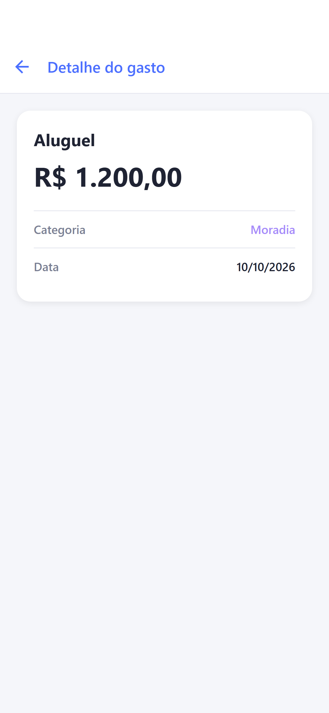
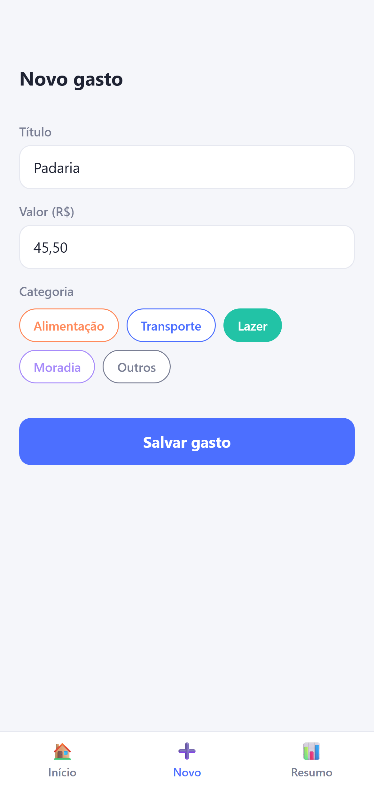
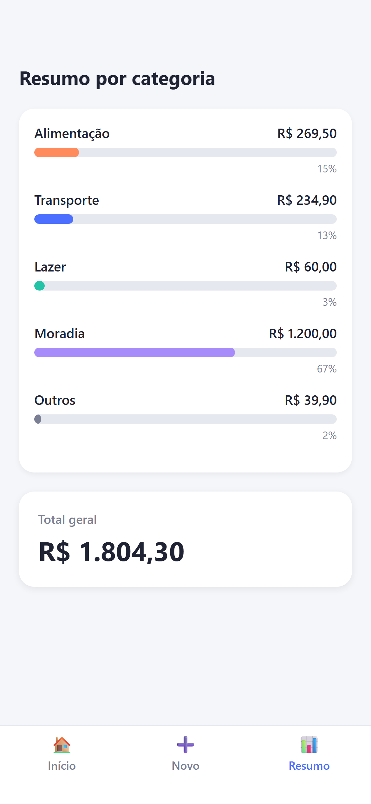
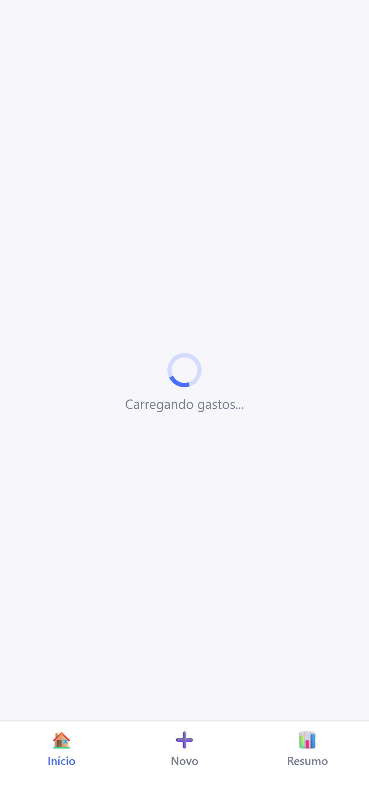
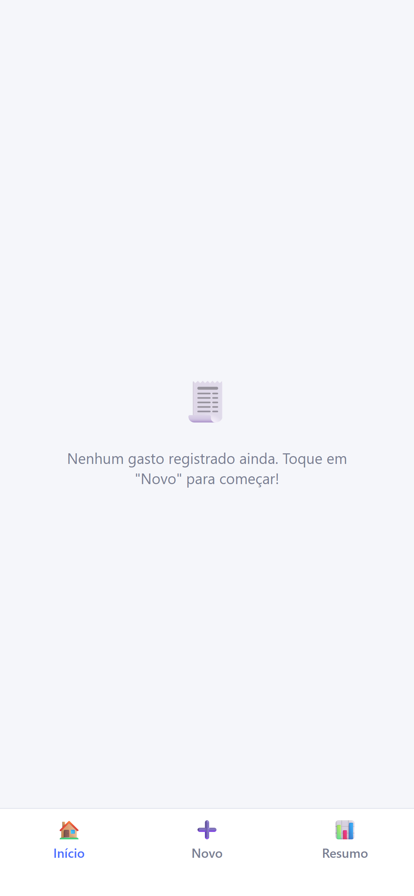
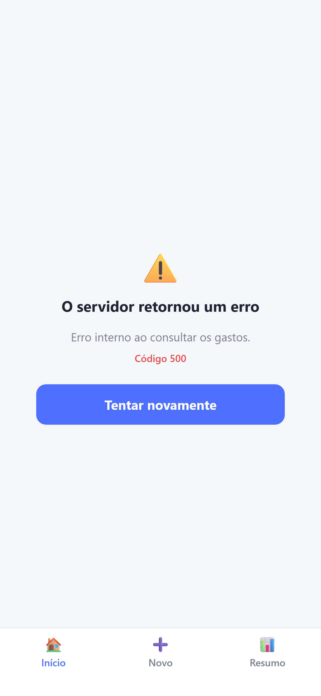
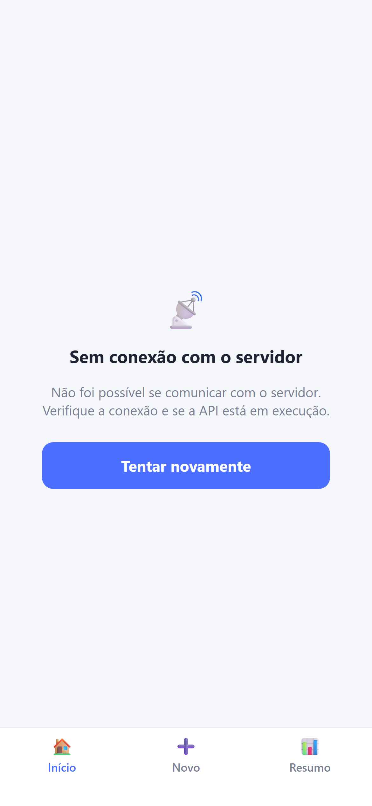
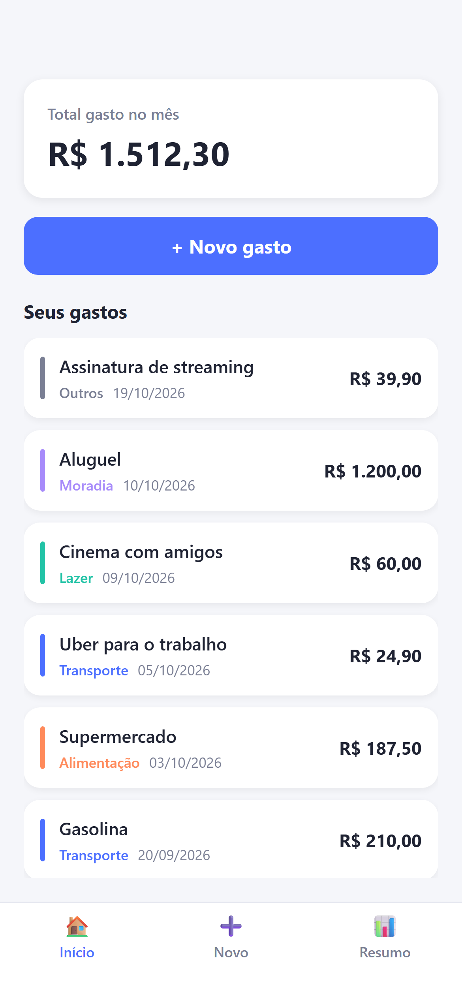
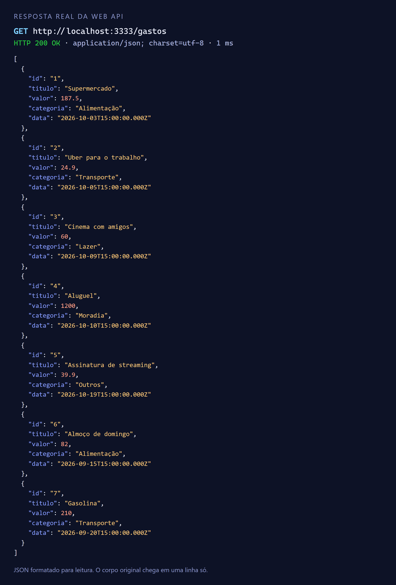

# Documentação do Checkpoint 2 — Controle de Gastos

Projeto Integrador de Programação Mobile — Toledo Prudente Centro Universitário.
Aplicativo em React Native (Expo SDK 57) com TypeScript.

> **Desenvolvimento com apoio de IA.** Este checkpoint foi desenvolvido por Bruno Oliveira Souza com a ajuda do Claude Code (Anthropic, modelo Claude Sonnet 5.5), que ajudou com ideias e com a lógica da solução e ajudou a programar: o Claude Code escreveu o código a partir das instruções do aluno, que definiu o escopo, aprovou o plano antes da implementação e testou o aplicativo no iPhone com o Expo Go. O detalhamento está na seção 9 e no Termo de Uso de IA Generativa entregue junto.

## 1. Evolução do projeto

### O que existia no Checkpoint 1

- Três telas (Início, Novo gasto, Resumo) com navegação feita por um `useState` no `App.tsx` e uma `TabBar` própria.
- Os gastos eram uma lista fixa de 5 exemplos escrita no código, mantida em memória. Nenhum dado vinha de fora do app.

### O que foi implementado neste checkpoint

- **Web API REST própria** (`api/server.js`), em Node puro, que entrega os gastos em JSON.
- **Camada de comunicação** (`src/services/`) que consulta a API com `fetch`, converte o JSON e traduz as falhas em erros tipados.
- **Hook `useGastos`** e **contexto `GastosProvider`**, que guardam os dados recebidos e o estado da consulta (carregando, sucesso, erro).
- **Componente `EstadoDaConsulta`**, que mostra ao usuário cada situação: aguardando resposta, falha de comunicação, erro do servidor, sem registros e dados.
- **React Navigation**: abas inferiores + pilha, com uma nova tela de **Detalhe do gasto**.

### O que foi alterado

| Antes (Checkpoint 1) | Agora (Checkpoint 2) |
| --- | --- |
| Gastos de exemplo fixos em `App.tsx` | Gastos buscados em `GET /gastos` |
| Navegação por `useState` + `TabBar` | React Navigation (abas e pilha); `TabBar.tsx` e `types/Tela.ts` foram removidos |
| Estado dos gastos em `App.tsx`, repassado por props | `GastosProvider` (contexto) lido pelas telas |
| Telas recebiam `gastos` e callbacks por props | Telas leem o contexto e usam o objeto `navigation` |
| Lista vazia tratada só na tela | Os 5 cenários tratados em um único componente |

O cadastro de gasto (tela **Novo**) continua funcionando e **não** envia dados à API, pois este checkpoint trata apenas de consulta (GET). O gasto cadastrado fica em memória, aparece junto com os da API e some ao fechar o app.

## 2. Navegação

Biblioteca: [React Navigation 7](https://reactnavigation.org/) (`@react-navigation/native`, `bottom-tabs` e `native-stack`).

### Telas

| Tela | Rota | Arquivo |
| --- | --- | --- |
| Início (total do mês e lista) | `Inicio` | `src/screens/HomeScreen.tsx` |
| Novo gasto (formulário) | `NovoGasto` | `src/screens/NovoGastoScreen.tsx` |
| Resumo por categoria | `Resumo` | `src/screens/ResumoScreen.tsx` |
| Detalhe do gasto | `DetalheGasto` | `src/screens/DetalheGastoScreen.tsx` |

### Estrutura e fluxo

```
Pilha (native-stack)
├── Abas (bottom-tabs)
│   ├── Inicio     ──toca num gasto──▶ DetalheGasto  (parâmetro: gastoId)
│   │              ──"+ Novo gasto"──▶ aba NovoGasto
│   ├── NovoGasto  ──salva──▶ volta para a aba Inicio
│   └── Resumo
└── DetalheGasto   (seta do cabeçalho volta para as Abas)
```

As rotas e seus parâmetros são tipados em `src/navigation/tipos.ts`; a montagem dos navegadores está em `src/navigation/AppNavigator.tsx`.

### Como os dados são transferidos entre as telas

1. **Parâmetro de rota:** ao tocar num gasto, a Home executa `navigation.navigate('DetalheGasto', { gastoId: item.id })`. A tela de detalhe lê `route.params.gastoId`.
2. **Estado compartilhado (contexto):** a lista de gastos fica no `GastosProvider`. A tela de detalhe usa o `gastoId` para buscar o gasto completo no contexto. Só o id viaja pela rota porque o gasto contém um `Date`, que não é um valor serializável pelo React Navigation.
3. **Novo gasto → Início:** a tela Novo chama `adicionarGasto` do contexto e depois `navigation.navigate('Inicio')`; a Home já exibe o novo item porque lê o mesmo contexto.

## 3. Integração com a Web API

A API é entregue junto com o projeto, na pasta `api/`. Roda com `npm run api`, usa só módulos nativos do Node (sem dependências) e responde em JSON com `Access-Control-Allow-Origin: *` (para o app rodando no navegador).

- **Endereço base:** `http://<IP-do-computador>:3333` (porta alterável por `PORT`).
- **Recurso:** `gastos`.
- **Entidade:** Gasto.

| Campo | Tipo | Exemplo |
| --- | --- | --- |
| `id` | texto | `"4"` |
| `titulo` | texto | `"Aluguel"` |
| `valor` | número | `1200` |
| `categoria` | texto (`Alimentação`, `Transporte`, `Lazer`, `Moradia` ou `Outros`) | `"Moradia"` |
| `data` | texto ISO 8601 | `"2026-10-10T15:00:00.000Z"` |

### Endpoints

| Método | Caminho | Resposta |
| --- | --- | --- |
| `GET` | `/gastos` | `200` com um array JSON de gastos (ou `[]`); `500` com `{ "mensagem": "..." }` no cenário de erro |
| `GET` | `/cenario` | `200` com o cenário ativo e os disponíveis |
| `GET` | `/cenario/:nome` | `200` trocando o cenário ativo (`normal`, `vazio`, `erro`, `lento`); `400` se o nome for inválido |

Qualquer outro caminho devolve `404` e métodos diferentes de GET devolvem `405`, sempre com `{ "mensagem": "..." }`.

Exemplo de resposta de `GET /gastos`:

```json
[
  { "id": "1", "titulo": "Supermercado", "valor": 187.5, "categoria": "Alimentação", "data": "2026-10-03T15:00:00.000Z" },
  { "id": "4", "titulo": "Aluguel", "valor": 1200, "categoria": "Moradia", "data": "2026-10-10T15:00:00.000Z" }
]
```

As datas dos exemplos são geradas sempre no mês atual (e duas no mês anterior), para que o "total do mês" faça sentido em qualquer dia.

### Cenários de simulação

Servem para demonstrar cada situação sem alterar o código do app. Troque o cenário abrindo a URL no navegador (ou com `curl`) e use **Tentar novamente** no app:

| Situação | Como provocar |
| --- | --- |
| Dados | `/cenario/normal` |
| Sem registros | `/cenario/vazio` |
| Aguardando resposta | `/cenario/lento` (3 s de atraso; ajustável com `ATRASO_LENTO_MS`) |
| Erro enviado pelo servidor | `/cenario/erro` |
| Falha na comunicação | encerrar a API (`Ctrl+C`) |

Também é possível definir o cenário inicial (`CENARIO=erro npm run api`) ou forçá-lo numa única requisição (`/gastos?cenario=vazio`).

### Organização no app

Os componentes visuais **não** conhecem `fetch`. A comunicação está isolada em `src/services/`:

| Arquivo | Responsabilidade |
| --- | --- |
| `config.ts` | Endereço base da API (`EXPO_PUBLIC_API_URL`, com padrão para emulador/navegador) |
| `http.ts` | `buscarJson`: GET com limite de 8 s; converte o corpo em JSON; lança `ErroDeRede` ou `ErroDoServidor` |
| `erros.ts` | Classes `ErroDeRede` e `ErroDoServidor` (com `status` e mensagem) |
| `gastoDto.ts` | Converte o JSON no tipo `Gasto` (texto ISO vira `Date`; categoria desconhecida vira `Outros`; dados inválidos viram `ErroDoServidor`) |
| `gastosService.ts` | `listarGastos()`: `GET /gastos` já convertido em `Gasto[]` |

## 4. Tratamento de estado

### Como os dados recebidos são armazenados

`src/hooks/useGastos.ts` guarda, com `useState`:

- `gastosDaApi`: o que veio de `GET /gastos`;
- `gastosLocais`: gastos cadastrados no app (ainda não enviados à API);
- `status`: `'carregando'`, `'sucesso'` ou `'erro'`;
- `erro`: o erro da última tentativa.

A consulta é uma função `async` (`try/catch` com `await listarGastos()`), disparada por `useEffect` quando o app abre e novamente pelo botão **Tentar novamente**. O resultado é exposto às telas por `GastosProvider` / `useGastosContext` (`src/context/GastosContext.tsx`).

### Como o carregamento é controlado

`carregar()` muda `status` para `'carregando'` antes da requisição e para `'sucesso'` ou `'erro'` ao terminar. Enquanto está `'carregando'`, as telas Início e Resumo mostram um indicador de atividade com "Carregando gastos...".

### Como os erros são apresentados

`src/components/EstadoDaConsulta.tsx` decide o que exibir, sempre com a barra de abas visível:

| Situação | Condição | O que o usuário vê |
| --- | --- | --- |
| Aguardando resposta | `status === 'carregando'` | Indicador de atividade e "Carregando gastos..." |
| Falha na comunicação | `status === 'erro'` e `ErroDeRede` | "Sem conexão com o servidor", mensagem explicativa e **Tentar novamente** |
| Erro enviado pelo servidor | `status === 'erro'` e `ErroDoServidor` | "O servidor retornou um erro", a mensagem enviada pela API, o código HTTP (ex.: `Código 500`) e **Tentar novamente** |
| API sem registros | `status === 'sucesso'` e nenhum gasto | Mensagem de lista vazia (texto próprio em Início e em Resumo) |
| API com dados | `status === 'sucesso'` e há gastos | Telas normais |

## 5. Requisitos obrigatórios do enunciado

| Requisito | Onde está |
| --- | --- |
| Navegação funcional entre as principais telas | `src/navigation/AppNavigator.tsx` |
| Interface com Flexbox | Todos os `StyleSheet` (`flexDirection`, `flex`, `alignItems`, `justifyContent`), p. ex. `GastoCard`, `EstadoDaConsulta`, `DetalheGastoScreen` |
| Integração com Web API e requisições HTTP | `src/services/http.ts`, `gastosService.ts` e `api/server.js` |
| Consulta com GET | `listarGastos()` → `GET /gastos` |
| Conversão do JSON retornado | `resposta.json()` em `http.ts` e `converterGasto` em `gastoDto.ts` |
| Renderização dos dados recebidos | `FlatList` da Home, barras da tela Resumo, `DetalheGastoScreen` |
| `async` e `await` | `buscarJson`, `listarGastos` e `carregar` (`useGastos`) |
| `useEffect` | `useGastos`, para buscar os dados ao abrir o app |
| Estado para os dados recebidos | `useState` em `useGastos` |
| Separação entre componentes visuais e comunicação com a API | `src/services/` não importa componentes; os componentes não usam `fetch` |

## 6. Como executar

```bash
npm install
npm run api          # terminal 1: sobe a API na porta 3333
npx expo start       # terminal 2: sobe o app
```

- **Emulador Android ou navegador:** funciona sem configuração (usa `10.0.2.2:3333` e `localhost:3333`).
- **Celular físico (Expo Go):** o celular e o computador precisam estar na mesma rede Wi-Fi. Ao subir, a API imprime o IP do computador; copie `.env.example` para `.env.local` e coloque esse endereço em `EXPO_PUBLIC_API_URL`. Se o Firewall do Windows perguntar, permita o acesso do Node à rede privada.

## 7. Limitações conhecidas

- O cadastro de gasto não é enviado à API (só `GET` neste checkpoint) e some ao fechar o app.
- Ao tentar novamente depois de um erro, os gastos cadastrados no app continuam na memória, mas ficam ocultos enquanto a tela mostra o erro.
- A API é um servidor de demonstração: os dados são fixos e não há banco de dados nem autenticação.
- O tráfego usa HTTP sem criptografia, adequado a desenvolvimento local; um build de produção exigiria HTTPS.

## 8. Capturas de tela

As capturas foram geradas a partir da versão web do próprio aplicativo (mesmo código), em tamanho de iPhone; não incluem a barra de status do aparelho. Os estados foram provocados com os cenários da API (`/cenario/lento`, `vazio`, `erro`) e com a API desligada.

### Telas (seção 2, Navegação)

| Início | Detalhe do gasto | Novo gasto | Resumo |
| --- | --- | --- | --- |
|  |  |  |  |

### Estados da consulta à Web API (seção 4, Tratamento de estado)

| Carregando | Sem registros | Erro do servidor (500) | Sem conexão | Com dados |
| --- | --- | --- | --- | --- |
|  |  |  |  |  |

### Integração com a Web API (seção 3)

Resposta real de `GET /gastos`, com o JSON formatado para leitura:



Os arquivos originais estão em `docs/img/`.

## 9. Uso de Inteligência Artificial

O desenvolvimento deste checkpoint contou com o Claude Code (Anthropic, modelo Claude Sonnet 5.5), que atuou como apoio durante todo o trabalho, sempre sob a direção do aluno.

**O que a IA fez**

- Ajudou com ideias: propôs a Web API própria em Node, em vez de uma API pública, e o React Navigation para a navegação.
- Ajudou com a lógica e a arquitetura: separação entre telas e comunicação com a API (`src/services`), hook `useGastos`, contexto `GastosProvider` e tratamento dos cinco cenários da consulta.
- Ajudou a programar: escreveu o código do aplicativo e da API a partir das instruções do aluno.
- Ajudou nos testes e na revisão de segurança, e na redação desta documentação, nas capturas de tela e no vídeo de apresentação.

**O que o aluno fez**

- Definiu o escopo do checkpoint e escolheu seguir com a Web API própria.
- Aprovou o plano antes da implementação.
- Executou o aplicativo no próprio iPhone, com o Expo Go, e conferiu as telas e os fluxos.
- Assume a autoria e a responsabilidade pelo projeto entregue.
