# Documentação Final (Checkpoint 3): Controle de Gastos

Projeto Integrador de Programação Mobile, Toledo Prudente Centro Universitário. Prof. Lenon Fachiano Silva.
Aluno: Bruno Oliveira Souza. Aplicativo em React Native (Expo SDK 57) com TypeScript.

> **Desenvolvimento com apoio de IA.** O projeto foi desenvolvido por Bruno Oliveira Souza com a ajuda do Claude Code (Anthropic). O aluno definiu o escopo e as decisões, e o Claude Code escreveu o código a partir das instruções dele. O detalhamento está na seção 10 e no Termo de Uso de IA Generativa entregue junto.

## 1. Visão geral

O **Controle de Gastos** é um aplicativo para registrar e acompanhar gastos pessoais. O usuário cadastra cada gasto (título, valor e categoria), consulta a lista e o total do mês, abre o detalhe de um gasto para editá-lo ou excluí-lo, e vê um resumo do quanto gastou em cada categoria.

Os dados ficam numa **Web API REST** própria, escrita em Node.js, que os grava num **banco de dados SQLite**. O app faz todas as operações de CRUD por essa API.

### Fluxo completo de utilização

1. O app abre na tela **Início**, que mostra "Carregando gastos..." enquanto consulta a API e, em seguida, o total do mês e a lista.
2. Em **Novo**, o usuário preenche o formulário. Se faltar algo, cada campo mostra o seu erro. Ao salvar, o gasto é enviado à API, um aviso verde confirma o cadastro e o app volta ao Início com o gasto já na lista.
3. Ao tocar num gasto, a tela **Detalhe** busca a versão mais recente na API e oferece **Editar** e **Excluir**.
4. **Editar** abre o mesmo formulário já preenchido. Ao salvar, o app volta ao detalhe com os dados novos.
5. **Excluir** pede confirmação, remove o gasto na API e volta ao Início.
6. **Resumo** mostra o total por categoria e o total geral.

## 2. Evolução do projeto

| Checkpoint 1 | Checkpoint 2 | Checkpoint 3 (final) |
| --- | --- | --- |
| Telas, componentes e estado local com dados fixos | React Navigation; Web API só com consulta (`GET`) e dados fixos | **CRUD completo** (`GET`, `POST`, `PUT`, `DELETE`) |
| Navegação por `useState` | Abas + pilha; tela de Detalhe | Nova tela **Editar gasto**; botões Editar/Excluir no Detalhe |
| Sem API | API com dados fixos em memória | API com **banco de dados SQLite**: os dados persistem |
| Validação com `Alert` | Erros só na consulta | Erros tratados em **todas** as operações: conexão, 404, 400, 500, carregamento |
| | Gasto novo ficava só na memória | Gasto novo é gravado no banco pela API |

### O que mudou neste checkpoint

- **API (`api/server.js`):** novas rotas `GET /gastos/:id`, `POST`, `PUT` e `DELETE`; validação dos dados no servidor (400 com a lista de erros); 404 para gasto inexistente; gravação em SQLite.
- **`src/services/http.ts`:** a função `requisitarJson` passou a aceitar método e corpo (antes só fazia GET) e trata a resposta 204 sem corpo.
- **`src/services/gastosService.ts`:** `buscarGasto`, `criarGasto`, `atualizarGasto` e `excluirGasto`.
- **`src/hooks/useGastos.ts`:** operações assíncronas que chamam a API e só atualizam a lista depois que a API confirma; "puxar para atualizar".
- **Novo componente `FormularioGasto`**, reutilizado no cadastro e na edição, com validação por campo e caixa de erro do servidor.
- **Nova tela `EditarGastoScreen`** e **Detalhe** com Editar/Excluir.
- **`AvisoContext`:** aviso rápido (toast) de sucesso ou erro após cada ação.
- **`BotaoPrimario`** ganhou as variantes `perigo`/`contorno` e o estado `carregando`.
- **`utils/dialogos.ts`:** confirmação que funciona no celular (`Alert`) e no navegador (`window.confirm`).

## 3. Requisitos obrigatórios do enunciado

### React Native

| Requisito | Onde está |
| --- | --- |
| React Native + TypeScript | Projeto Expo `blank-typescript`; `npx tsc --noEmit` sem erros |
| Estrutura organizada de arquivos | `src/` dividido em `components`, `screens`, `navigation`, `services`, `hooks`, `context`, `types`, `constants`, `utils` (seção 7) |
| Componentes reutilizáveis | `FormularioGasto` (cadastro e edição), `BotaoPrimario` (3 variantes), `EstadoDaConsulta` (Início e Resumo), `GastoCard`, `CategoriaChip`, `ResumoCard`, `BarraCategoria` |
| Propriedades | `FormularioGasto` recebe `inicial`, `onSalvar`, `erroDoServidor`; `BotaoPrimario` recebe `variante`, `carregando`; `GastoCard` recebe os dados do gasto |
| Estados | `useState` em `useGastos` (lista, status, erro), no formulário (campos, erros, salvando) e no Detalhe (carregando / ok / não encontrado / erro) |
| Eventos | `onPress` nos botões e chips, `onChangeText` nos campos, `onRefresh` da lista |
| Renderização condicional | `EstadoDaConsulta` (carregando, erro, vazio, dados); erros por campo; Detalhe com 4 estados; botão mostra indicador enquanto salva |
| Renderização de listas | `FlatList` no Início; `map` nas categorias do formulário e nas barras do Resumo |

### Interface

| Requisito | Onde está |
| --- | --- |
| Estilos organizados | `StyleSheet.create` em cada arquivo; paleta central em `src/constants/cores.ts` |
| Flexbox | `flexDirection`, `flex`, `flexWrap`, `alignItems`, `justifyContent` em todos os componentes (p. ex. `GastoCard`, chips do formulário, barras do Resumo) |
| Interface coerente | Mesmas cores, cartões, botões e espaçamentos em todas as telas |
| Feedback visual das ações | Toast verde "Gasto cadastrado", "Alterações salvas", "Gasto excluído"; toast vermelho em falhas; botão com indicador e bloqueado durante o envio |
| Mensagens adequadas | Mensagens em português, específicas para cada erro (seção 6) |
| Listas vazias | "Nenhum gasto registrado ainda. Toque em "Novo" para começar!" (Início) e mensagem própria no Resumo |
| Indicação de carregamento | `ActivityIndicator` na carga da lista e do detalhe, no botão durante o envio e no "puxar para atualizar" |

### Navegação

| Requisito | Onde está |
| --- | --- |
| Navegação funcional | React Navigation 7: abas (Início, Novo, Resumo) + pilha (Detalhe, Editar) em `src/navigation/AppNavigator.tsx` |
| Fluxo coerente | Cadastrar → volta ao Início; Editar → volta ao Detalhe; Excluir → volta ao Início |
| Transferência de parâmetros | `gastoId` passado para `DetalheGasto` e `EditarGasto`, tipado em `src/navigation/tipos.ts` |
| Retorno às telas anteriores | Seta do cabeçalho, `navigation.goBack()` após salvar/excluir, botão "Voltar" nas telas de erro |

### Integração com a Web API (CRUD)

| Operação | Rota | App |
| --- | --- | --- |
| **C**reate | `POST /gastos` | `criarGasto` ← `NovoGastoScreen` |
| **R**ead | `GET /gastos` e `GET /gastos/:id` | `listarGastos` ← Início; `buscarGasto` ← Detalhe |
| **U**pdate | `PUT /gastos/:id` | `atualizarGasto` ← `EditarGastoScreen` |
| **D**elete | `DELETE /gastos/:id` | `excluirGasto` ← botão Excluir do Detalhe |

### Tratamento de erros

| Situação | Como o app trata |
| --- | --- |
| Falha de conexão | `fetch` que falha ou passa de 8 s vira `ErroDeRede`: tela "Sem conexão com o servidor" com "Tentar novamente"; no formulário, caixa de erro e dados preservados |
| API indisponível | Mesmo tratamento (API desligada recusa a conexão); cenário `erro` simula a API respondendo 500 |
| Dados não encontrados | 404 no Detalhe/Editar/Excluir: tela "Gasto não encontrado", o gasto sai da lista local e o app volta |
| Erros de validação | No app: erro por campo (título, valor, categoria) antes de enviar. Na API: 400 com a mensagem exibida no formulário |
| Respostas HTTP de erro | Qualquer status fora de 2xx vira `ErroDoServidor` com o código e a mensagem enviada pela API |
| Carregamento de informações | Status `carregando` com indicador; JSON inválido ou fora do formato também vira erro tratado (`gastoDto.ts`) |

## 4. Web API

Servidor HTTP em Node.js puro, sem dependências externas, em `api/server.js`. Porta 3333.

| Método | Rota | Corpo | Respostas |
| --- | --- | --- | --- |
| GET | `/gastos` | | 200 lista |
| GET | `/gastos/:id` | | 200 gasto, 404 |
| POST | `/gastos` | `{ titulo, valor, categoria, data? }` | 201 gasto criado, 400 |
| PUT | `/gastos/:id` | `{ titulo, valor, categoria, data? }` | 200 gasto alterado, 400, 404 |
| DELETE | `/gastos/:id` | | 204, 404 |

- Erros sempre vêm em JSON: `{ "mensagem": "..." }`; no 400 também `"erros": [...]` com cada problema.
- Validação no servidor: título obrigatório (até 80 caracteres), valor numérico maior que zero e menor que 1 milhão, categoria entre as 5 aceitas e data em ISO 8601 (opcional; no POST, o padrão é o momento do cadastro).
- Corpo limitado a 10 KB; JSON malformado responde 400; consultas parametrizadas (sem concatenar SQL).
- CORS liberado só para o Expo Web (porta 8081, configurável em `CORS_PORTA`) e POST/PUT exigem `Content-Type: application/json` (415 caso contrário): assim, outro site aberto no navegador não consegue alterar os gastos.

**Cenários de demonstração** (para provocar as situações na apresentação): `GET /cenario/normal`, `/cenario/vazio`, `/cenario/lento` (respostas em 3 s) e `/cenario/erro` (todas as rotas de `/gastos` respondem 500).

## 5. Banco de dados

SQLite, pelo módulo nativo `node:sqlite` do Node.js (versão 22.5 ou superior). Não precisa instalar nada.

```sql
CREATE TABLE IF NOT EXISTS gastos (
  id        INTEGER PRIMARY KEY AUTOINCREMENT,
  titulo    TEXT    NOT NULL,
  valor     REAL    NOT NULL CHECK (valor > 0),
  categoria TEXT    NOT NULL,
  data      TEXT    NOT NULL
)
```

- O arquivo `api/gastos.db` é criado automaticamente na primeira execução da API, com 7 gastos de exemplo.
- Os dados ficam gravados entre execuções.
- `npm run api:reset` apaga os gastos e grava os exemplos de novo.

## 6. Como executar

Pré-requisitos: Node.js 22.5 ou superior; Expo Go no celular (opcional).

```bash
npm install
npm run api          # terminal 1: API + banco (porta 3333)
npx expo start       # terminal 2: app ("w" abre no navegador, ou leia o QR code com o Expo Go)
```

- **Navegador ou emulador Android:** funciona sem configuração.
- **Celular físico ou navegador em outro computador:** copie `.env.example` para `.env.local` e coloque em `EXPO_PUBLIC_API_URL` o IP do computador que roda a API (o terminal da API mostra esse endereço). Mesma rede Wi-Fi. Se o Firewall do Windows perguntar, permita o Node na rede privada.

## 7. Estrutura de pastas

```
api/server.js                  Web API REST + banco SQLite
src/
  components/                  FormularioGasto, BotaoPrimario, EstadoDaConsulta, GastoCard,
                               CategoriaChip, ResumoCard, BarraCategoria
  screens/                     HomeScreen, NovoGastoScreen, DetalheGastoScreen,
                               EditarGastoScreen, ResumoScreen
  navigation/                  AppNavigator (abas + pilha) e tipos das rotas
  services/                    config, http, erros, gastoDto, gastosService, mensagemDeErro
  hooks/useGastos.ts           lista, estado da consulta e operações de CRUD
  context/                     GastosContext (dados) e AvisoContext (feedback)
  types/Gasto.ts               Gasto, GastoInput, Categoria
  constants/                   categorias e cores
  utils/                       formatarMoeda, formatarData, dialogos
App.tsx                        provedores + navegação
```

A comunicação com a API fica isolada em `src/services/`: as telas e os componentes nunca chamam `fetch` diretamente.

## 8. Capturas de tela

Geradas a partir da versão web do próprio aplicativo (mesmo código), em tamanho de celular. Os estados foram provocados com os cenários da API.

### Fluxo principal (CRUD)

| Início (lista) | Validação no app | Cadastrado (POST) | Detalhe (GET por id) |
| --- | --- | --- | --- |
|  | 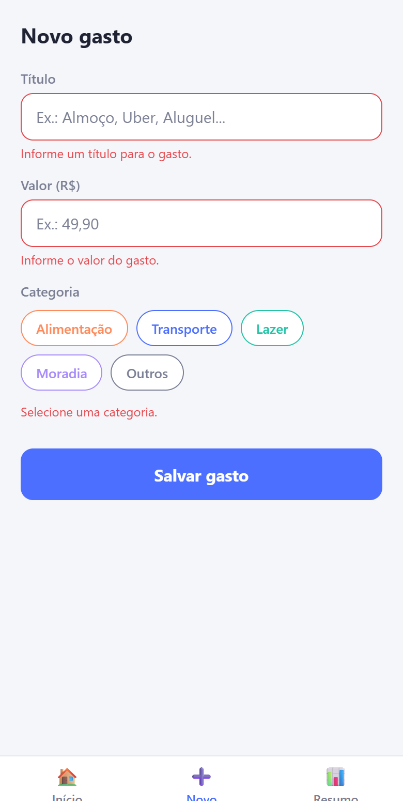 |  | 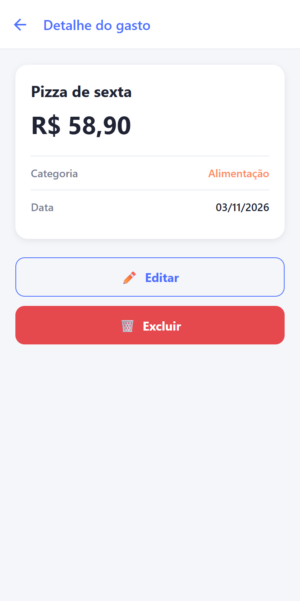 |

| Editar | Alterado (PUT) | Excluído (DELETE) | Resumo |
| --- | --- | --- | --- |
| 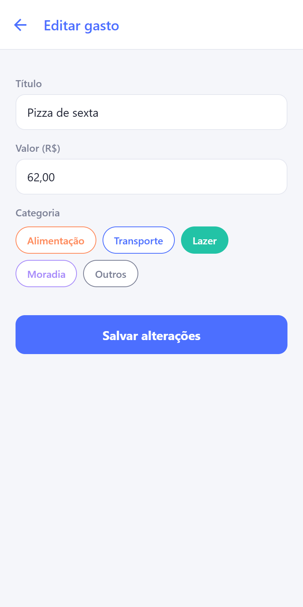 | 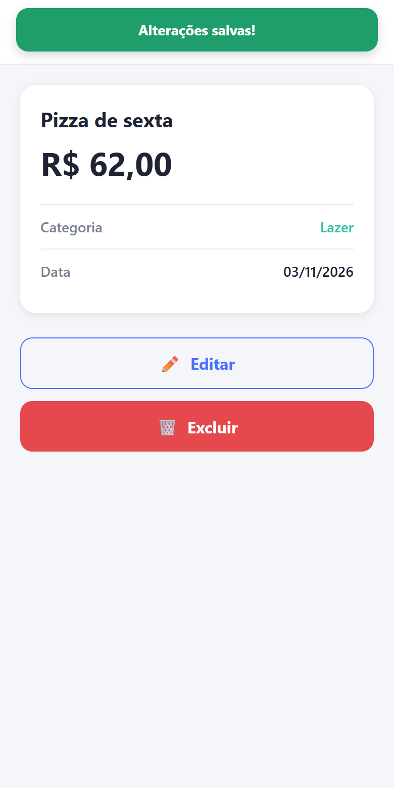 | 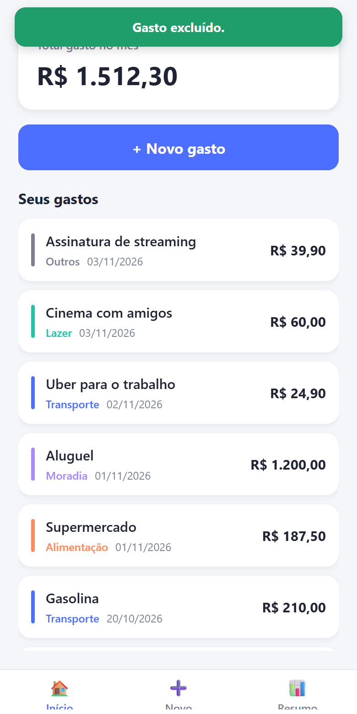 | 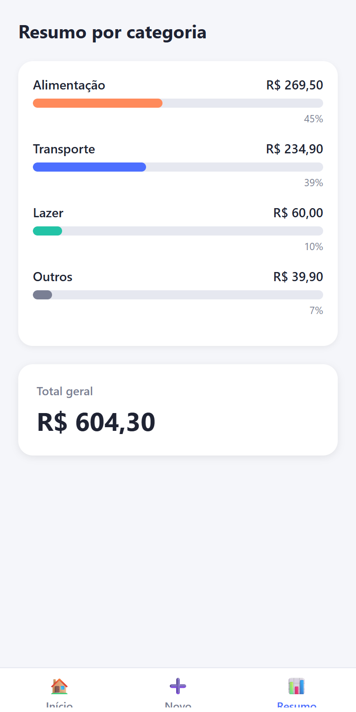 |

### Tratamento de erros e estados

| Carregando | Lista vazia | Erro 500 na lista | Erro 500 ao salvar | Não encontrado (404) |
| --- | --- | --- | --- | --- |
| 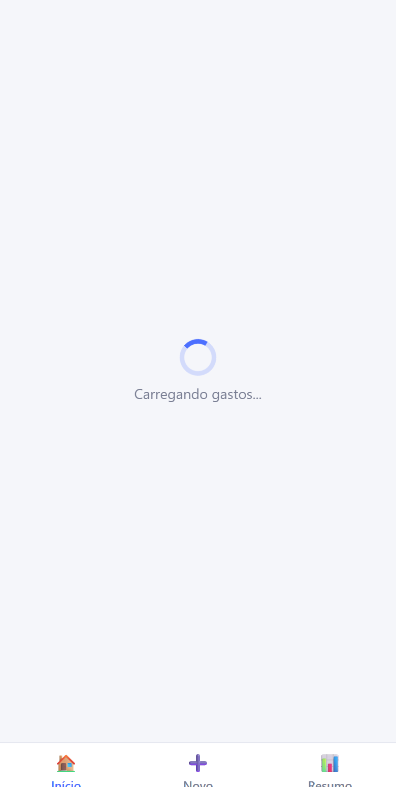 | 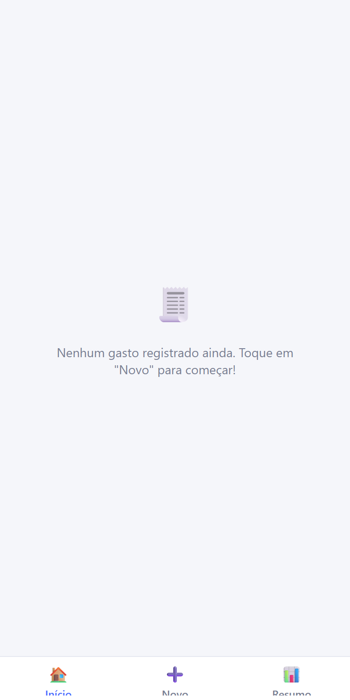 | 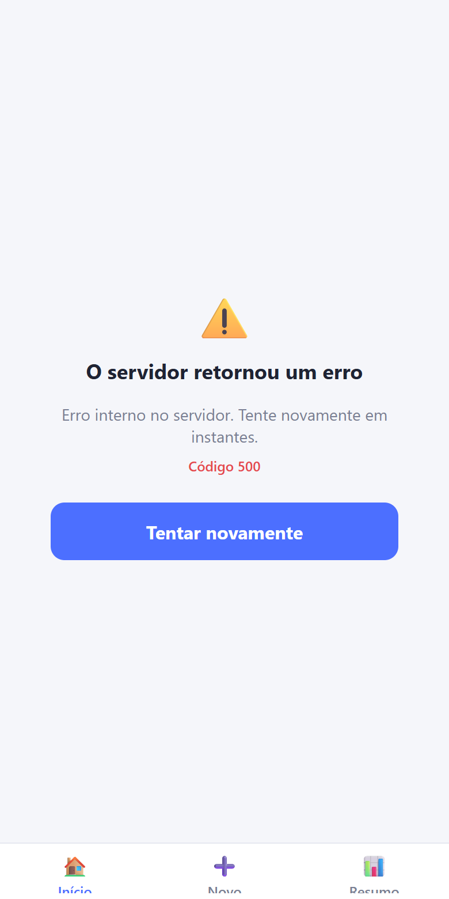 | 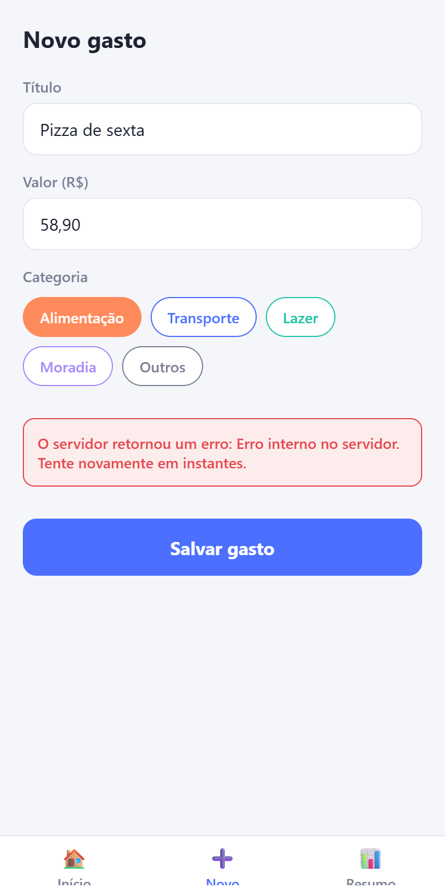 | 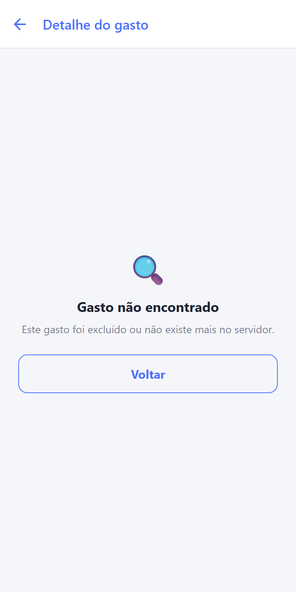 |

A tela de falha de conexão (API desligada) é a mesma do Checkpoint 2 (`docs/img/08-sem-conexao.png`).

## 9. Limitações conhecidas

- Não há login: todos os gastos pertencem a um único usuário.
- A data do gasto é a do cadastro; o formulário não permite escolher outra data (a API já aceita o campo `data`).
- O tráfego usa HTTP sem criptografia, adequado para desenvolvimento local; um build de produção exigiria HTTPS e autenticação.
- O módulo `node:sqlite` ainda é marcado como experimental pelo Node.js (o aviso é ocultado no script `npm run api`).

## 10. Uso de Inteligência Artificial

O projeto contou com o Claude Code (Anthropic) como apoio em todos os checkpoints, sempre sob a direção do aluno. No Checkpoint 3 foi usado o modelo Claude Opus 5.5.

**O que a IA fez**

- Leu o enunciado do Checkpoint 3 e comparou com o estado do projeto, apontando o que faltava (CRUD, banco de dados, tratamento de erros nas operações de escrita).
- Propôs a solução: SQLite nativo do Node (sem instalar servidor de banco) e um formulário reutilizável para cadastro e edição.
- Escreveu o código da API, do banco e do app a partir das instruções do aluno.
- Testou o fluxo completo no navegador (cadastrar, editar, excluir, erros 400/404/500) e gerou as capturas e esta documentação.

**O que o aluno fez**

- Definiu o escopo e autorizou o plano ("pode começar").
- Conferiu o funcionamento e apresenta o projeto.
- Assume a autoria e a responsabilidade pelo projeto entregue.
